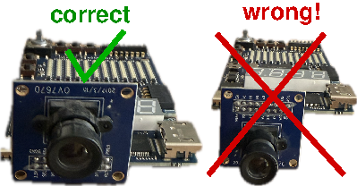

# Setup - macOS

## CAD Tools

- Download the *OSS-CAD-suite* (https://github.com/YosysHQ/oss-cad-suite-build/releases)
- Extract the contents of the *OSS-CAD-suite* with:
  ```sh
  tar -xf oss-cad-suite-darwin-arm64-<date>.tgz
  ```
- Move the tools to your `/opt/` directory by using:
  ```sh
  sudo mv oss-cad-suite /opt/
  ```
- You have to activate your tools by:
  ```sh
  cd /opt/oss-cad-suite
  sudo ./activate
  ```
  **Note**: This process takes a while.
- Add the *OSS-CAD-suite* to the PATH variable by opening your `/etc/paths` file with `sudo` in your favorite editor and add the following at the end:
  ```sh
  PATH=/opt/oss-cad-suite/bin
  ```

## Compiler

**Warning**: Compiling the cross-compiler takes several hours.
**Note**: This description is based on *MacPort*, the same thing can also be done with *Homebrew*.

- Install *MacPort* (https://www.macports.org/install.php) if not already present.
- Open a terminal.
- Download the required packages with the following command:
  ```sh
  sudo port install gcc15 git wget guile-2.2 gsed
  ```
- Clone the toolchain from GitHub by executing the following:
  ```sh
  git clone https://github.com/EPFL-LAP/or1kToolchain.git
  ```
- Download more by executing this list of commands:
  ```sh
  cd or1kToolchain/gnu_src
  wget ftp.gnu.org/gnu/binutils/binutils-2.45.tar.bz2
  wget mirror.koddos.net/gcc/releases/gcc-15.2.0/gcc-15.2.0.tar.gz
  git clone git://sourceware.org/git/cgen.git
  ```
- Before building the toolchain you have to make sure that you are using the port version of gcc, g++ and sed.
  - To use the port version of gcc, g++ and sed you can do following in the terminal:
    ```sh
    sudo su
    cd /opt/local/bin
    ln -s g++-mp-15 g++
    ln -s gcc-mp-15 gcc
    ln -s gsed sed
    exit
    export PATH=/opt/local/bin:$PATH
    ```
  - To verify that everything is set up correctly:
    ```sh
    gcc --version
    ```
    The result should be:
    ```sh
    gcc (MacPorts gcc15 15.1.0_3+stdlib_flag) 15.1.0
    ```
- Build the toolchain by:
  ```sh
  cd ../patch
  sudo ./compile_mac.sh
  ```
- Add the compiler to the PATH variable by opening your `/etc/paths` file with `sudo` in your favorite editor and add the following at the end:
  ```
  /opt/or1k_toolchain/bin
  ```
- Check if the compiler has been installed correctly by executing `or1k-elf-gcc -version`. The output should be:
  ```
  or1k-elf-gcc (GCC) 15.2.0
  Copyright (C) 2025 Free Software Foundation, Inc.
  This is free software; see the source for copying conditions.  There is NO
  warranty; not even for MERCHANTABILITY or FITNESS FOR A PARTICULAR PURPOSE.
  ```
  If that isn't the output you see, restart the terminal and check again.
- Compile and install the *convert_or32* utility:
  ```sh
  cd ../convert_or32
  gcc -O2 -o convert_or32 read_elf.c convert_or32.c
  sudo mv convert_or32 /opt/or1k_toolchain/bin/
  ```

## Camera Viewer

To view the output, you will require camera viewing software, unless you have a screen to hook up the HDMI output to. A free solution is *OBS* (https://obsproject.com/):

- Download & open *OBS*
- In the *Sources* tab, press the + button and select *Video Capture Device*
- In the pop-up window (*Properties for 'Video Capture Device'*), select *SandbergCapture*
  - The *HDMI Capture Link to USB* must be connected to your computer.
  - If Video doesn't update, you can deactive & reactive the capture device in the *Properties* window.

Alternatively, you can use *Webcamoid* (https://github.com/webcamoid/webcamoid/releases), though if you want to download the executables you need to pay or compile it yourself.

## Serial Terminal

In order to load the program (binary) on the board, you will need to send it over UART to the softcore. You require a program capable of sending files over a serial port.
One such program is *CoolTerm* (https://freeware.the-meiers.org/).

These are the required UART settings:

- Baud rate: 115200
- Data Bits: 8
- Flow Control: None
- Parity: None
- Stop Bits: 1

## Hardware

- Connect the OV7670 camera to the board:

  
<!--  -->
- Connect the HDMI cable to the board.
- Connect the other end of the HDMI cable to either the *HDMI Capture Link to USB* or a screen.
- Connect the USB cable to the board, then your computer.

# Usage Instructions - macOS

## Bitstream

### Loading

If you wish to load the provided bitstream [or1300SingleCore.bit](../bit/or1300SingleCore.bit), run the following:
```sh
openFPGALoader or1300SingleCore.bit
```

### Generating

If you wish to modify the softcore and generate a new bitstream, run the [`synthesizeOr1300.sh`](../soc/or1300/synthesizeOr1300.sh) script.

**Note**: If you decide to read through the Verilog on your own, keep in mind that the Verilog macro `GECKO5Education` is defined - it's passed in `synthesizeOr1300.sh`.

## Binary (Executable)

### Loading

**Warning**: when transfering a binary to the softcore, the softcore must be in its reset state (press the *Reset* button on the board). The board will print the following if it has been reset:

```
CS-473 System programming for systems on chip
Openrisc based virtual Prototype.
Build version: Thu Aug 28 06:56:14 AM CEST 2025

I am CPU 1 of 1 running at 59.40 MHz.

Known RS232 commands:
** Start the program loaded in target
*p Set programming mode (default)
*v Set verification mode
*i Show info on program in target
*t Toggle target between SDRam (default), soft-Bios and Flash
*m Perform simple SDRam memcheck
*s Check SPI-flash chip
*e Erase SPI-Flash chip
*f Store program loaded in SDRAM to SPI-Flash
*c Compare program loaded in SDRAM with SPI-Flash
*r Run program stored in SPI-Flash
*q Toggle stack pointer from SDRAM (default) with SPM
*h This helpscreen
```

(*Virtual Prototype* is the term EPFL uses for their softcore.)

To send the binary, follow these steps:

- Connect the board.
- Open *CoolTerm* (or whatever serial port software you use).
- Send [camera.cmem](../bin/camera.cmem).
- The terminal will not send anything back during transfer, but you will see the progress on the screen output of the board.
- Once the transfer has completed, it will print `Download: done`.
- To start your program, send `**`.
- If you want to load a new program, remember that you need to reset the softcore (not the whole board, just the softcore).

### Generating

A base binary is provided, so (re)compile the binary only if you want to change the binary. If that is the case, run the [`Makefile`](../soc/camera-program/Makefile) by executing `make`. Rerun this command every time you want to recompile the binary.
