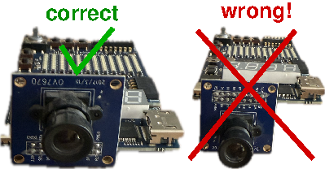

# Setup - Windows (native)

## CAD Tools

- Download *MSYS2* (https://www.msys2.org/).
- Once *MSYS2* is installed, open a *MSYS2 MSYS* terminal.
- Download the required packages with the following command:
  ```sh
  pacman -S mingw-w64-x86_64-yosys mingw-w64-x86_64-nextpnr mingw-w64-x86_64-prjtrellis mingw-w64-x86_64-openFPGALoader
  ```
- If you wish to use these tools in a Windows console, you need to add the path where *MSYS2* is installed to Windows' PATH environment variable (default *MSYS2* path is `C:\msys64\usr\bin`).

For convenience, it's recommended to use the *MSYS2 MSYS* packages. However, instead of using *MSYS2 MSYS*, you can alternatively use *MSYS2 UCRT64*. In that case you need to download the following packages:

```sh
pacman -S mingw-w64-ucrt-x86_64-yosys mingw-w64-ucrt-x86_64-nextpnr mingw-w64-ucrt-x86_64-prjtrellis mingw-w64-ucrt-x86_64-openFPGALoader
```

Though, if you use the *MSYS2 UCRT64* packages, they won't be available through the *MSYS2 MSYS* terminal, unless you add them to *MSYS2*'s PATH variable.

## Board Driver

**Warning**: You might have to redo this process after a Windows update or restart of your laptop. Windows randomly reverts the device drivers, so check the driver if you can't connect to the board.

As the tools are based on libusb, you must change the device driver for the GECKO5Education. There are two ways to go about this.

### Zadig

*Zadig* is a GUI tool that allows you to (re)install and replace drivers.

- Download *Zadig* (https://zadig.akeo.ie/) and start it.
- Plug in your GECKO5Education board.
- Press the *ESP32 bootmode* button and keep it pressed until the driver has finished installing.
- Go to *Options* and click *List All Devices*.
- In the drop-down list select *Dual RS232-HS (Interface 0)*.
  - It's possible that *Zadig* will revert your selection after about a second. In that case, either be fast enough with the selection or use the second method to replace the driver.
- Click on the button *Replace Driver* (this can take a while).
- Check if you can detect your board by executing `openFPGALoader -detect`. This is the output you will see if it was successful:
  ```
  empty
  No cable or board specified: using direct ft2232 interface
  Cannot read iSerialNumber field from FTDI: considered as empty string
  Jtag frequency : requested 6.00MHz   -> real 6.00MHz
  index 0:
          idcode 0x41113043
          manufacturer lattice
          famely ECP5
          model  LFE5U-85
          irlength 8
  ```

### wdi-simple

*wdi-simple* is the tool that *Zadig* is based on, but is CLI only.

- Download the `wdi-simple.zip` archive from the course's Moodle page.
- Once it has been downloaded, unzip the archive.
- Run
  ```sh
  wdi-simple.bat
  ```
- Check if you can detect your board by executing `openFPGALoader -detect`. This is the output you will see if it was successful:
  ```
  empty
  No cable or board specified: using direct ft2232 interface
  Cannot read iSerialNumber field from FTDI: considered as empty string
  Jtag frequency : requested 6.00MHz   -> real 6.00MHz
  index 0:
          idcode 0x41113043
          manufacturer lattice
          famely ECP5
          model  LFE5U-85
          irlength 8
  ```

## Compiler

There are two ways of installing the compiler required to cross-compile for the softcore: download a pre-compiled version or compile it yourself.

### Pre-Compiled

- Install *make* by executing the following in a *MSYS2 MSYS* terminal:
  ```sh
  pacman -S make
  ```
  You don't need *make* now, but you will need it later.
- Download the `or1k_toolchain.zip` archive from the course's Moodle page.
- Once it has been downloaded, unzip the top-level archive.
- Run the `install_windows.sh` script in a *MSYS2 MSYS* terminal.
- Check if the compiler has been installed correctly by executing `or1k-elf-gcc -version`. The output should be:
  ```
  or1k-elf-gcc (GCC) 15.2.0
  Copyright (C) 2025 Free Software Foundation, Inc.
  This is free software; see the source for copying conditions.  There is NO
  warranty; not even for MERCHANTABILITY or FITNESS FOR A PARTICULAR PURPOSE.
  ```
  If that isn't the output you see, restart the terminal and check again.

### Self-Compile

**Warning**: Compiling the cross-compiler takes several hours.

- Open a *MSYS2 MSYS* terminal. Every step hereafter **must** be completed in this type of terminal.
- Download the required packages with the following command:
  ```sh
  pacman -S git gcc diffutils guile zlib texinfo patch rsync make
  ```
- Clone the toolchain from GitHub by executing the following:
  ```sh
  git clone https://github.com/EPFL-LAP/or1kToolchain.git
  ```
- Download more by executing this list of commands:
  ```sh
  cd or1kToolchain/gnu_src
  wget ftp.gnu.org/gnu/binutils/binutils-2.45.tar.bz2
  wget mirror.koddos.net/gcc/releases/gcc-15.2.0/gcc-15.2.0.tar.gz
  git clone git://sourceware.org/git/cgen.git
  ```
- Build the toolchain by:
  ```sh
  cd ../patch
  ./compile_linux.sh
  ```
- Add the compiler to the *MSYS* PATH variable:
  ```sh
  echo "export PATH=/opt/or1k_toolchain/bin:$PATH" >> ~/.bashrc
  source ~/.bashrc
  ```
- Check if the compiler has been installed correctly by executing `or1k-elf-gcc -version`. The output should be:
  ```
  or1k-elf-gcc (GCC) 15.2.0
  Copyright (C) 2025 Free Software Foundation, Inc.
  This is free software; see the source for copying conditions.  There is NO
  warranty; not even for MERCHANTABILITY or FITNESS FOR A PARTICULAR PURPOSE.
  ```
  If that isn't the output you see, restart the terminal and check again.
- Compile and install the *convert_or32* utility:
  ```sh
  cd ../convert_or32
  gcc -O2 -o convert_or32 read_elf.c convert_or32.c
  mv convert_or32.exe /opt/or1k_toolchain/bin/
  ```

## Camera Viewer

To view the output, you will require camera viewing software, unless you have a screen to hook up the HDMI output to. A free solution is *OBS* (https://obsproject.com/):

- Download & open *OBS*
- In the *Sources* tab, press the + button and select *Video Capture Device*
- In the pop-up window (*Properties for 'Video Capture Device'*), select *SandbergCapture*
  - The *HDMI Capture Link to USB* must be connected to your computer.
  - If Video doesn't update, you can deactive & reactive the capture device in the *Properties* window.

Alternatively, you can use *Webcamoid* (https://github.com/webcamoid/webcamoid/releases), though if you want to download the executables you need to pay or compile it yourself.

## Serial Terminal

In order to load the program (binary) on the board, you will need to send it over UART to the softcore. You require a program capable of sending files over a serial port (COM port). One such program is *Tera Term* (https://github.com/TeraTermProject/teraterm/releases), another is *CoolTerm* (https://freeware.the-meiers.org/), yet another is *Bray++* (https://sites.google.com/site/terminalbpp/).

These are the required UART settings:

- Baud rate: 115200
- Data Bits: 8
- Flow Control: None
- Parity: None
- Stop Bits: 1

## Hardware

- Connect the OV7670 camera to the board:

  
<!--  -->
- Connect the HDMI cable to the board.
- Connect the other end of the HDMI cable to either the *HDMI Capture Link to USB* or a screen.
- Connect the USB cable to the board, then your computer.

# Usage Instructions - Windows

## Bitstream

### Loading

If you wish to load the provided bitstream [or1300SingleCore.bit](../bit/or1300SingleCore.bit), run the following:
```sh
openFPGALoader or1300SingleCore.bit
```

### Generating

If you wish to modify the softcore and generate a new bitstream, run the [`synthesizeOr1300.sh`](../soc/or1300/synthesizeOr1300.sh) script in a *MSYS2 MSYS* terminal. Alternatively, if you have added the CAD tools to your Windows PATH environment variable, you can run the [`synthesizeOr1300.bat`](../soc/or1300/synthesizeOr1300.bat) script instead.

**Note**: If you decide to read through the Verilog on your own, keep in mind that the Verilog macro `GECKO5Education` is defined - it's passed in `synthesizeOr1300.sh`.

## Binary (Executable)

### Loading

**Warning**: when transfering a binary to the softcore, the softcore must be in its reset state (press the *Reset* button on the board). The board will print the following if it has been reset:

```
CS-473 System programming for systems on chip
Openrisc based virtual Prototype.
Build version: Thu Aug 28 06:56:14 AM CEST 2025

I am CPU 1 of 1 running at 59.40 MHz.

Known RS232 commands:
** Start the program loaded in target
*p Set programming mode (default)
*v Set verification mode
*i Show info on program in target
*t Toggle target between SDRam (default), soft-Bios and Flash
*m Perform simple SDRam memcheck
*s Check SPI-flash chip
*e Erase SPI-Flash chip
*f Store program loaded in SDRAM to SPI-Flash
*c Compare program loaded in SDRAM with SPI-Flash
*r Run program stored in SPI-Flash
*q Toggle stack pointer from SDRAM (default) with SPM
*h This helpscreen
```

(*Virtual Prototype* is the term EPFL uses for their softcore.)

If you use *Tera Term*, it should have auto-configured itself to the settings above. To send the binary using *Tera Term*, follow these steps:

- Connect the board.
- In *Tera Term*, click *Setup > Terminal...*
- Under New-line, change the *Receive option* to *AUTO*
- Press ok, then click *File > New Connection...*
- In the popup, select the *Serial* option and select the *COMXX: USB Serial Port* (not *Serial Device*).
- Click *File > Send File...*
  - Find the [camera.cmem](../bin/camera.cmem) file in the dropdown menu
  - The *File reading method* doesn't matter
  - Check the *Binary* box
  - Use the *no delay* option
- The terminal will not send anything back during transfer, but you will see the progress on the screen output of the board.
- Once the transfer has completed, it will print `Download: done`
- To start your program, send `**` (in *Tera Term* you just type it, it sends input immediately).
- If you want to load a new program, remember that you need to reset the softcore (not the whole board, just the softcore).

### Generating

A base binary is provided, so (re)compile the binary only if you want to change the binary. If that is the case, run the [`Makefile`](../soc/camera-program/Makefile) by executing `make`. Rerun this command every time you want to recompile the binary.
